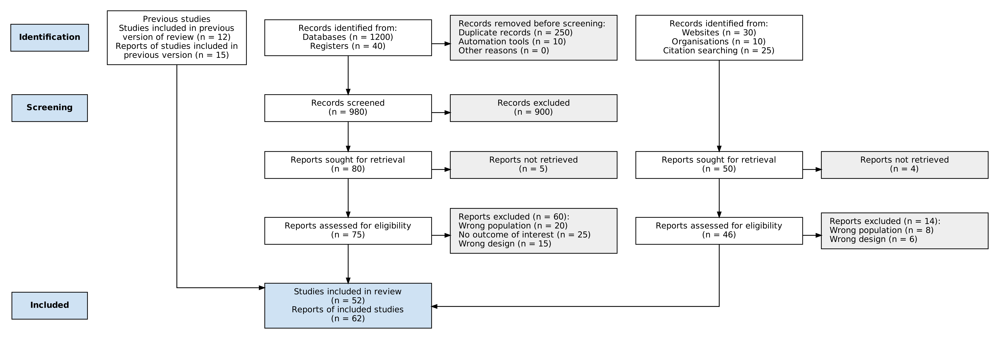

# Moses Luke PrismaGraphpy
PRISMA 2020 flow diagram generator in Python

[](https://doi.org/10.5281/zenodo.24004986)

Create **PRISMA 2020** systematic review flow diagrams in Python. Give it your screening counts (in code or a CSV) and it produces a publication-ready diagram as PNG, SVG or PDF, plus an **interactive HTML** version in which readers can hover for tooltips and click boxes to open supporting files.

It is built on Graphviz, so it runs in scripts, notebooks and CI pipelines without a browser.

`pip install moseslukeprismagraphpy`, then `import moseslukeprismagraphpy` in Python or run the `prismagraph` command in a terminal. The source lives in the GitHub repository `Moses-L/prismaflow`.

## Why this exists

The [PRISMA2020 R package and Shiny app](https://doi.org/10.1002/cl2.1230) (Haddaway et al., 2022) made PRISMA 2020 diagrams easy for R users. `moseslukeprismagraphpy` offers the same kind of workflow for Python users. It is an independent reimplementation, not a port of that code, and it is not affiliated with the PRISMA group or the R package authors. Please also cite the original tool and the PRISMA 2020 statement if they informed your work (see [Citing](#citing)).

## Features

- PRISMA 2020 layout for new reviews, with optional **previous studies** and **other methods** (websites, organisations, citation searching) arms
- Downstream numbers (screened, sought, assessed, included totals) are calculated for you, and impossible counts raise a clear error
- Warns when the number of included reports does not match your assessed and excluded counts
- CSV template so counts can be shared, versioned and re-run
- Outputs: PNG, SVG, PDF, interactive HTML, Graphviz DOT
- Command-line tool and Python API

## Install

```bash
pip install moseslukeprismagraphpy
```

`moseslukeprismagraphpy` needs the Graphviz program (not only the Python wrapper):

| System | Command |
|---|---|
| Ubuntu / Debian | `sudo apt install graphviz` |
| macOS | `brew install graphviz` |
| Windows | Installer from [graphviz.org/download](https://graphviz.org/download/); tick the option to add Graphviz to PATH, then restart the terminal |
| conda | `conda install -c conda-forge graphviz` |

To install the latest unreleased version straight from GitHub instead: `pip install git+https://github.com/Moses-L/prismaflow`.

## Example output



## Quick start

### From the command line

```bash
prismagraph template -o my_review.csv        # blank template
# fill in the n column, then:
prismagraph draw my_review.csv -o figures/prisma -f png svg html
prismagraph draw --example -o demo -f png    # built-in worked example
```

### From Python

```python
from moseslukeprismagraphpy import PrismaData, render

data = PrismaData(
    counts={
        "identified_databases": 1200,
        "identified_registers": 40,
        "duplicates": 250,
        "excluded_automatic": 10,
        "excluded_screening": 900,
        "not_retrieved": 5,
        "new_studies": 40,
        "new_reports": 47,
    },
    reasons_db={"Wrong population": 20, "No outcome of interest": 25, "Wrong design": 15},
    urls={"identified_databases": "https://osf.io/your-search-strategy"},
    tooltips={"identified_databases": "PubMed, Embase, CENTRAL; searched 1 Nov 2026"},
)
print(data.validate())                       # list of warnings; raises on impossible counts
render(data, "figures/prisma", formats=["png", "svg", "html"])
```

## CSV format

Columns: `data, label, n, url, tooltip` (extra columns such as `notes` are ignored).

| `data` value | Meaning |
|---|---|
| `identified_databases`, `identified_registers` | Records identified |
| `duplicates`, `excluded_automatic`, `excluded_other` | Records removed before screening |
| `excluded_screening` | Records excluded at title/abstract |
| `not_retrieved` | Reports not retrieved |
| `reason_db` | One row per full-text exclusion reason: put the reason in `label` and the count in `n` |
| `new_studies`, `new_reports` | Studies and reports included |
| `previous_studies`, `previous_reports` | Turns on the previous-version arm |
| `other_websites`, `other_organisations`, `other_citation_searching` | Turns on the other-methods arm |
| `other_sought`, `other_not_retrieved`, `reason_other` | Other-methods retrieval and exclusions |
| `screened`, `sought`, `assessed`, `excluded_fulltext`, `other_assessed`, `other_excluded`, `total_studies` | Calculated boxes: leave `n` empty and use only `url` and `tooltip` |

## Interactive HTML

Add a `url` and/or `tooltip` to any row. In the HTML output, hovering shows the tooltip and clicking opens the link. SVG and PDF keep the links too; PNG does not. Link to your own protocols, search strategies or lists of DOIs. Avoid linking to exported database records or abstracts, because database terms of use and copyright may not allow sharing them.

## Limitations

- Phase labels ("Identification", "Screening", "Included") are horizontal boxes, not the rotated side banners of the official template.
- Layout is automatic. Very long exclusion-reason lists make wide boxes, so keep reason text short.
- Only the new-review templates with previous and other-methods arms are implemented. Please open an issue if you need something else.

## Examples

The `examples/` folder has a filled-in `example.csv`, a blank `template.csv`, and the matching PNG, SVG and interactive HTML output.

## Development

```bash
git clone https://github.com/Moses-L/prismaflow && cd prismaflow
pip install -e ".[dev]"
pytest
```

## Citing

If you use `moseslukeprismagraphpy`, please cite this software (see `CITATION.cff`) and the PRISMA 2020 statement:

- Page MJ, McKenzie JE, Bossuyt PM, et al. The PRISMA 2020 statement: an updated guideline for reporting systematic reviews. *BMJ* 2021;372:n71. https://doi.org/10.1136/bmj.n71
- Haddaway NR, Page MJ, Pritchard CC, McGuinness LA. PRISMA2020: An R package and Shiny app for producing PRISMA 2020-compliant flow diagrams, with interactivity for optimised digital transparency and Open Synthesis. *Campbell Systematic Reviews* 2022;18:e1230. https://doi.org/10.1002/cl2.1230

## Licence

MIT. See `LICENSE`.
